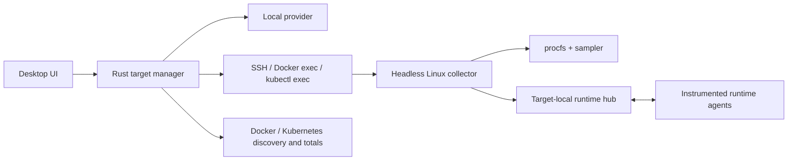

# Remote process monitoring for Peak

Researched 2026-11-06 against the then-current source and first-party documentation, as a design recommendation. It has since been implemented; see [REMOTE-VALIDATION.md](REMOTE-VALIDATION.md) for what was built and what has actually been tested.

## Recommendation

Support all three through **targets**: a local machine, SSH host, Docker container, or Kubernetes container. Reuse a small headless Linux collector for Peak's detailed process monitoring; use Docker/Kubernetes discovery and aggregate metrics where available without a collector.

Start with read-only SSH process discovery and attachment. That exercises the reusable collector and connection model before adding container deployment and Kubernetes permissions. Launching commands, stopping them, and runtime profiling should follow once observation works reliably.

Wrapping `peak run -- ssh …`, `docker exec …`, or `kubectl exec …` currently monitors the **local client process**, not the remote workload. Forwarding the current hub socket alone also cannot fix this: the desktop still reads local `/proc` using the PID supplied by the client.

## What the existing code gives us

The backend already has useful boundaries, but assumes one local Linux environment:

| Existing part | Reusable behavior | Change needed |
|---|---|---|
| [`procfs.rs`](../src-tauri/src/procfs.rs), [`sampler.rs`](../src-tauri/src/sampler.rs) | Process enumeration, process trees, CPU/I/O deltas, memory and descriptor counts | Execute beside the workload; use that environment's clock ticks and process namespace |
| [`monitor.rs`](../src-tauri/src/monitor.rs) | History, deltas, PID start-time checks, attach/capture lifecycle | Separate target ownership, connection state, and remote event ingestion |
| [`runner.rs`](../src-tauri/src/runner.rs) | Output capture, exit information, process-group signaling | Run on the target; add direct executable/argv launches alongside `/bin/sh -c` |
| [`hub.rs`](../src-tauri/src/hub.rs) and runtime scripts | Node/Python heap telemetry, GC, snapshot requests | Host the hub and agent files on the target; relay results to the desktop |
| [`cli.rs`](../src-tauri/src/cli.rs) | Register a launched command and tee its output | Current registration sends a PID and receives local agent paths; it is not a remote monitoring protocol |
| [`MonitorApi`](../src/lib/monitor-api.ts), [`types.ts`](../src/lib/types.ts) | Stable frontend operations and chart data | Add target IDs, capabilities, per-target system information and connection errors |

`list_attachable` intentionally filters to the collector's own UID. Remote support should preserve that default and report inaccessible fields explicitly. The current sampler silently returns some missing counters as zero; that would misrepresent permissions failures on remote targets. Existing stop/shutdown/restart operations invoke local signaling or recapture locally, so every action needs target routing before remote records enter the UI. These observations come directly from the linked repository code.

## Feasibility by environment

| Target | Discovery without installing Peak | Detailed per-process sampling | Runtime heap/GC |
|---|---|---|---|
| SSH Linux host | Run a process-list command over SSH | Collector reading remote `/proc` | Target-side startup instrumentation or an already integrated runtime agent |
| Docker engine/container | Container inventory, `top`, container statistics, logs | Collector in the container, or a host collector with explicit namespace mapping | Agent files and connectivity inside the workload environment |
| Kubernetes | Pods/containers/status/logs; optional Metrics API | Exec a collector in the selected container, or use an explicitly deployed debugging/monitoring container | Cooperative instrumentation; pod discovery does not attach a profiler |

**Container totals and process-tree measurements are different series.** Docker stats and Kubernetes resource metrics cannot fill every existing Peak chart field. Missing heap, GC, descriptors, or per-process I/O should remain unavailable rather than being fabricated from container totals. Docker documents container CPU/memory/I/O statistics; Kubernetes documents CPU/memory resource metrics for nodes and pods. ([Docker stats](https://docs.docker.com/reference/cli/docker/container/stats/), [Kubernetes resource metrics](https://kubernetes.io/docs/tasks/debug/debug-cluster/resource-metrics-pipeline/))

For container capacity, add cgroup-aware metadata rather than treating `/proc/meminfo` as the container's memory limit. On cgroup v2, `memory.max` records the hard memory limit and `cpu.max` records CPU bandwidth quota/period; account for unlimited values, ancestor constraints, CPU affinity and cgroup v1 hosts. Keep Peak's current CPU convention (100% = one core) explicit, with quota utilization as a separate value. A process tree is also not a container membership list: independently exec'd or reparented processes may sit outside the selected root's descendants. ([Linux cgroup v2](https://docs.kernel.org/admin-guide/cgroup-v2.html), [current CPU convention](../src/lib/types.ts))

### SSH hosts

OpenSSH already provides encrypted remote command execution, configured identities, jump hosts, host-key checking, and forwarding. Prefer invoking the user's installed `ssh` initially, retaining their existing configuration. Use `-T` for the collector protocol and keep stdin open for requests; PTY terminal behavior is unnecessary for structured data. OpenSSH returns the remote command's status, or 255 on an SSH error, so a transport failure must not automatically become the monitored program's crash. ([OpenSSH manual](https://man.openbsd.org/ssh))

**Proposed approach:** install or explicitly bootstrap a versioned collector into a user-writable target directory, select the correct Linux architecture, then keep one SSH session running it. Collect remotely and send batches, rather than repeatedly spawning SSH for every `/proc` read. The initial scope can be Linux x86-64 and arm64; Windows/macOS SSH targets require different collectors.

The remote UID and kernel policy govern what is visible. `/proc` restrictions, including `hidepid` and access checks, can prevent inspection of other users' processes. Treat restricted fields as partial capability, not as process exit. ([Linux `/proc` documentation](https://www.kernel.org/doc/html/latest/filesystems/proc.html))

### Docker containers, including remote Docker

Use an explicitly selected Docker context. Contexts can already address remote engines through SSH, so we do not need an SSH server inside each application container. Pass `docker --context NAME …` per invocation rather than changing the user's global selection. Access still requires permission to use the selected daemon. ([Docker contexts](https://docs.docker.com/engine/manage-resources/contexts/), [protecting the daemon socket](https://docs.docker.com/engine/security/protect-access/))

A useful first version can discover containers, show process listings with `docker top`, and stream `docker stats` and logs. Docker's Engine API also exposes container listing/inspection, top, stats, logs, events, and exec operations, providing a future direct API path. ([Engine API](https://docs.docker.com/reference/api/engine/version/v1.51/))

On Linux, Docker's process listing is produced by the daemon invoking `ps` and filtering the container's task PIDs. It does not require `ps` inside the application image. These PIDs belong to the daemon's process view; never assume they equal PIDs reported by an agent inside the container, especially with Docker Desktop or a remote engine. ([Moby implementation](https://github.com/moby/moby/blob/master/daemon/top_unix.go))

**For full Peak metrics:** run the same collector using `docker exec -i`, without a TTY, after making its binary available inside that container. Docker exec starts a new executable and supports environment/work-directory options; the command stops being relevant when the container's primary process ends and is not automatically restarted with the container. Shell syntax requires an actual shell. ([Docker exec](https://docs.docker.com/reference/cli/docker/container/exec/))

A read-only filesystem, missing executable, incompatible architecture/libc, or blocked execution can prevent the helper path. Offer aggregate monitoring when this happens. Do not silently add privileged mode or mount the Docker socket into workloads. Normal rootful daemon access is powerful; use existing local/SSH/TLS access rather than exposing an unauthenticated TCP daemon. ([Docker daemon access](https://docs.docker.com/engine/security/protect-access/))

### Kubernetes pods

Treat the selected scope as **context → namespace → pod UID → container instance**, not just a pod name. Discover pod/container metadata through the Kubernetes API or `kubectl get … -o json`, then select the actual container explicitly. The Pod API provides listing, watching, logs, and exec; exec receives an argv array and does not implicitly invoke a shell. ([Pod API](https://kubernetes.io/docs/reference/kubernetes-api/core/pod-v1/))

**Practical first path:** a persistent `kubectl --context … -n … exec -i POD -c CONTAINER -- /path/to/collector …` session. This carries commands and structured results through the existing API connection. It requires a collector binary in the container and permission to exec. Do not run a fresh exec for every sample. ([kubectl exec](https://kubernetes.io/docs/reference/kubectl/generated/kubectl_exec/))

Metrics Server is optional and serves aggregate CPU/memory measurements for autoscaling. It is useful for a pod overview, but is not a process enumeration API or a substitute for Peak's 500 ms process sampler. Discover the available metrics API version rather than hardcoding one. ([Resource metrics pipeline](https://kubernetes.io/docs/tasks/debug/debug-cluster/resource-metrics-pipeline/))

Minimal images require an explicit alternative:

- **Prepared application image/shared volume:** include a compatible collector ahead of time. `kubectl cp` requires `tar` in the destination container, so it is not a universal bootstrap mechanism. ([kubectl cp](https://kubernetes.io/docs/reference/kubectl/generated/kubectl_cp/))
- **Ephemeral debugging container:** supply our own collector image and target the application container's process namespace. This changes the pod's debug configuration, requires additional permissions, and depends on runtime support; targeting is not guaranteed to expose the desired processes. Keep this an explicit debugging action. ([Debugging running pods](https://kubernetes.io/docs/tasks/debug/debug-application/debug-running-pod/))
- **Monitoring sidecar:** sharing the pod network is insufficient for process discovery. Cross-container process visibility requires process namespace sharing or another deliberate mechanism. A debug/sidecar filesystem also does not automatically contain the application executable or instrumentation scripts, so observation and launching must remain separate capabilities. ([Process namespace sharing](https://kubernetes.io/docs/tasks/configure-pod-container/share-process-namespace/))

A node collector/DaemonSet could eventually cover many pods, but introduces host process visibility, container/PID attribution, node deployment, and broader permissions. It is a different operational product from an on-demand desktop connection; defer it until continuous fleet monitoring is a requirement.

Ephemeral containers cannot be changed or removed after addition, and are not automatically restarted. Ending the collector process therefore does not remove its entry from the pod; explain this persistence before offering that deployment path. ([Ephemeral containers](https://kubernetes.io/docs/concepts/workloads/pods/ephemeral-containers/))

### Kubernetes permissions

Keep permissions tied to the selected features, preferably through namespaced Roles:

| Feature | Permission to evaluate |
|---|---|
| Browse pods | `get/list/watch` on `pods` |
| Container logs | `get` on `pods/log` |
| Resource overview | Relevant `get/list` permissions in `metrics.k8s.io`, when installed |
| Run the helper/commands | `pods/exec`: plan for `create`; some client/cluster combinations also require `get` for WebSocket upgrade |
| Forward to a collector listener | Corresponding `pods/portforward` connection permissions |
| Add a debugging container | Explicit update/patch access to `pods/ephemeralcontainers`, plus applicable admission policy |

Kubernetes represents subresources separately in RBAC; HTTP methods map to authorization verbs. WebSocket GET upgrades can additionally require `create` when `AuthorizePodWebsocketUpgradeCreatePermission` is enabled, including exec and port-forward. Verify the actual client/cluster requirements instead of requesting a wildcard role. Exec access is command execution even if Peak uses it only to observe processes. ([RBAC](https://kubernetes.io/docs/reference/access-authn-authz/rbac/), [authorization](https://kubernetes.io/docs/reference/access-authn-authz/authorization/), [WebSocket authorization feature](https://kubernetes.io/docs/reference/command-line-tools-reference/feature-gates/))

## Shared architecture

This is a proposed design based on the code and capabilities above:

Extract a Tauri-independent Rust core and a separate collector binary. The current CLI and desktop share the Tauri crate; shipping the complete desktop executable to a minimal server is the wrong packaging boundary. Keep remote network I/O outside the monitor's shared mutex so one slow host cannot block local sampling.

Use a versioned bidirectional protocol over stdio: handshake/capabilities, process listing, attachment, sample/log events, and later launch/signal/profile requests. Include request IDs, target/session IDs, sequence numbers, bounded frames and buffers, and a full-state resync operation. Reserve helper stdout for protocol messages; encode workload stdout/stderr as events and keep transport diagnostics separate.

Retain authentication in SSH, Docker, or Kubernetes. The runtime hub should listen locally **on the target**, then multiplex telemetry over the collector session. Forwarding only today's desktop hub would still return desktop agent paths and interpret remote PIDs locally. The current runtime token is a tracked-process identifier, so do not promote that protocol into a public network service.

A listener-based collector is a later option. SSH can forward ports, and `kubectl port-forward` connects a local port to a pod listener. Kubernetes port-forward is not a reverse callback from the pod to the desktop, and sessions end when the selected pod terminates. ([OpenSSH forwarding](https://man.openbsd.org/ssh), [kubectl port-forward](https://kubernetes.io/docs/reference/kubectl/generated/kubectl_port-forward/))

## Correct behavior to preserve

These are implementation requirements inferred from the current model and remote failure modes:

- **Identity:** use target + boot/container generation + PID namespace + PID + start ticks. Store pod UID and container ID; a reused name/PID must not inherit history or receive a signal intended for its predecessor.
- **Disconnect:** track connecting/connected/stale/disconnected independently of running/exited/crashed. Losing a connection is not evidence of workload exit. Show gaps; reconnect by verifying process identity and fetching a snapshot. Use sequences for deduplication: the frontend currently deduplicates sample deltas by wall-clock timestamp.
- **Time and metrics:** calculate CPU/I/O rates using target-local elapsed time. Keep remote wall time and desktop receipt time distinct. Label host capacity, container limits, process RSS, and container working set separately.
- **Logs:** capture exact streams for helper-launched commands. Existing-process attachment cannot promise historical stdout/stderr; offer separately labeled container logs where the platform records them. Docker logging configuration and Kubernetes rotation/retention constrain availability. ([Docker logs](https://docs.docker.com/engine/logging/), [Kubernetes logging](https://kubernetes.io/docs/concepts/cluster-administration/logging/))
- **Control:** detach and stop monitoring by default for existing workloads. Route explicit process signals through the target collector after identity validation; killing a local `ssh`/`kubectl` client is not a remote cancellation contract. Container-wide kill targets the container's main process, so it must be a distinct action. ([Docker kill](https://docs.docker.com/reference/cli/docker/container/kill/))
- **Restart:** retain a target-specific launch specification for commands Peak launched. Do not recapture an attached service locally, delete a pod, or restart a container as an implicit substitute. Desktop shutdown must not terminate existing remote services.
- **Profiling:** transport does not add instrumentation. Node/Python scripts currently load at startup; the Go examples cooperate with Peak. Arbitrary existing processes gain OS metrics first. Add heap/GC only when an agent is present, with target-visible script paths and runtime support. A shellless image needs direct argv launch support; shipping the helper alone does not make the current `/bin/sh -c` runner work.

## Suggested delivery order

1. **Target model and provider boundary.** Keep local behavior working; add target IDs, capability/missing-value semantics and connection state.
2. **SSH observation spike.** Build the headless collector, list same-user processes, attach, and stream existing CPU/memory/I/O charts. Verify permission failures, reconnect, PID reuse and remote clock changes.
3. **Docker discovery and observation.** Reuse contexts, provide container totals/process listings/logs without a helper, and enable detailed charts for prepared containers. Verify remote engines and host/container PID differences.
4. **Kubernetes observation.** Browse namespace/pod/container, show logs and optional aggregate metrics, and connect to a prepared collector through exec. Verify restricted RBAC, multiple containers, pod replacement and minimal-image fallback before offering ephemeral containers.
5. **Launch, control and profiling.** Add remote command specifications, verified stop/escalation, output capture, runtime script distribution and profile requests. Define disconnect behavior for owned commands explicitly; durable jobs require a supervisor or persistent collector, not an assumption about exec-session survival.

Use installed CLIs first to reuse authentication and configuration. Move selected Docker/Kubernetes operations to native API clients only when dependency packaging, streaming overhead, or scale justifies the extra implementation work. The first proof should demonstrate the same process and charts over SSH with a reliable disconnect/reconnect path; that validates the foundation shared by all three integrations.

Rust client candidates for a later phase are [Bollard](https://docs.rs/bollard/latest/bollard/) for Docker (including optional SSH transport) and [kube](https://docs.rs/kube/latest/kube/api/struct.Api.html) for Kubernetes listing/watching, exec, logs and port-forwarding. Their transport support does not by itself establish parity with the user's existing CLI configuration and authentication; validate that before replacing a working CLI provider.
